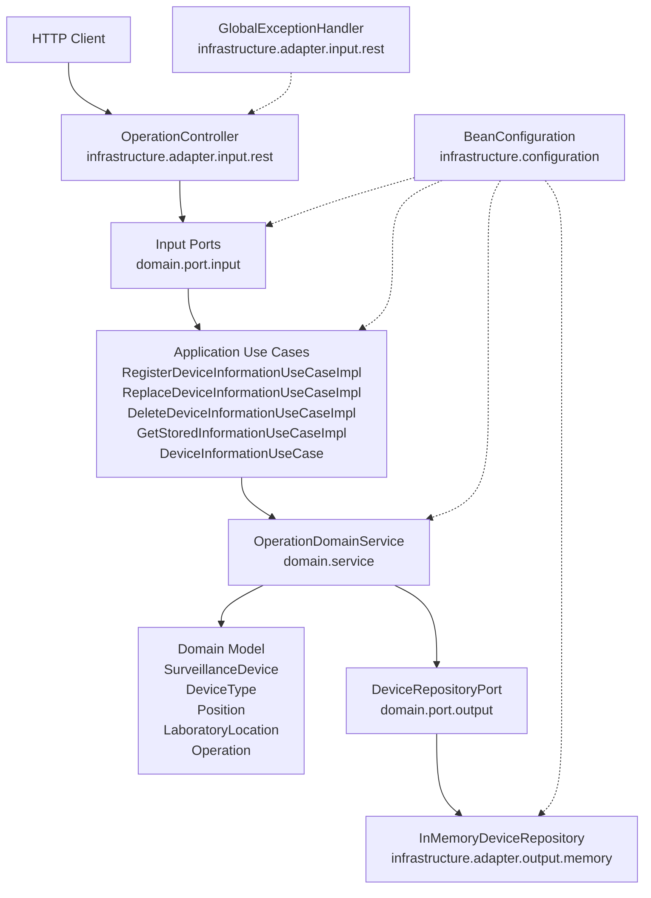
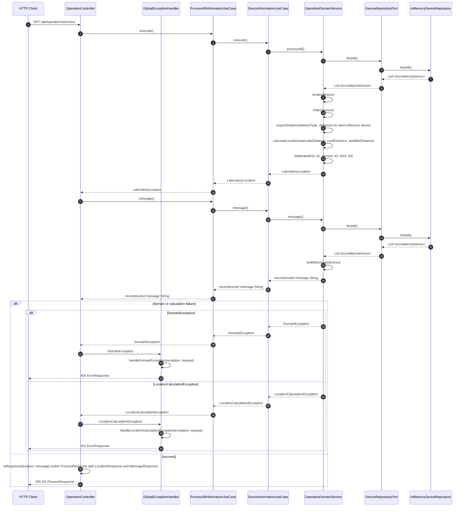
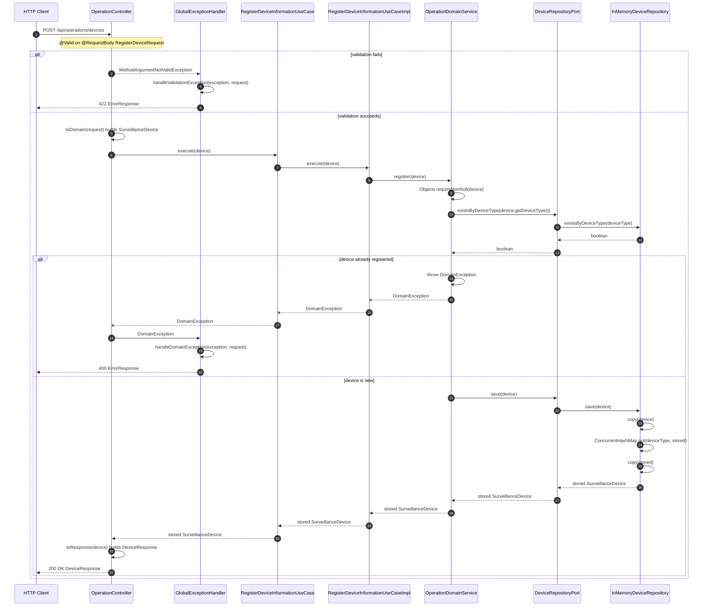
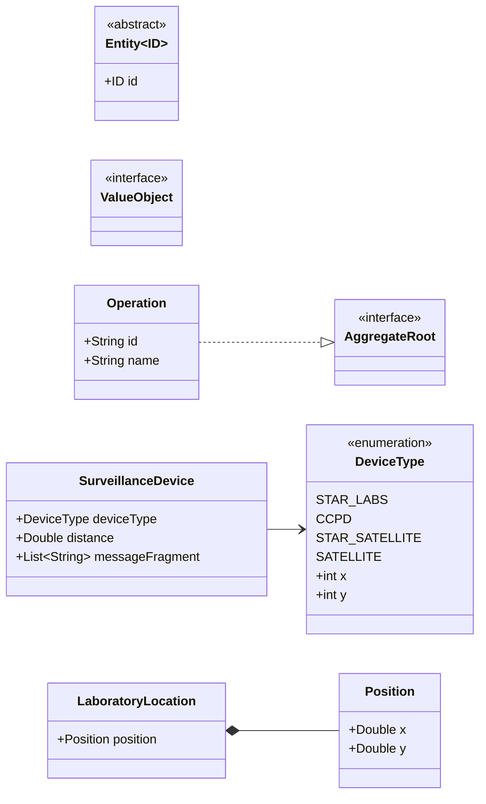

# Software Design Document (SDD)

## Cover Page

| Field | Value |
|---|---|
| Document title | Software Design Document (SDD) |
| Document type | Software design and architecture specification |
| Project | `alchemy-operation` |
| Version | `0.0.1-SNAPSHOT` |
| Date | 2026-11-19 |
| Author | Not specified in repository files |
| Review context | Academic review and software auditing |
| Document status | Baseline derived from the current repository implementation |
| Scope of truth | Source code, tests, `pom.xml`, configuration files, and repository documentation present in this workspace |
| Primary package root | `com.alchemy.operation` |

This document describes the system as implemented. The assignment specification was provided externally and is not stored in this repository; where it is not available in-repository, the text identifies repository evidence explicitly instead of inferring external requirements.

---

## 1. Document Information

- **Project Name:** `alchemy-operation`
- **Version:** `0.0.1-SNAPSHOT`
- **Date:** 2026-11-19
- **Author:** Not specified in repository files
- **Project Description:** Domain-driven hexagonal architecture scaffold for alchemy operations (from `pom.xml`)
- **Technology Baseline:** Java 21, Spring Boot 3.5.16, Maven, Lombok, Spring Web, Spring Validation, Spring Boot Test
- **Repository Structure Summary:**
  - Maven-based Java project.
  - Main source root: `src/main/java/com/alchemy/operation`
  - Test source root: `src/test/java/com/alchemy/operation`
  - Main packages: `domain`, `application`, `infrastructure`
  - Configuration: `pom.xml`, `src/main/resources/application.properties`, `infrastructure/configuration/BeanConfiguration.java`
  - Generated outputs: `bin/`, `target/`
  - Documentation present: `README.md`, `docs/architecture.md`, `docs/domain-model.md`, and this `docs/SDD.md`
  - The assignment specification was provided externally and is not stored in the repository; no source file contains literal `F1`-`F6` identifiers.

---

## 2. Project Objectives

### Primary objectives

1. Provide a maintainable implementation for the device-information lifecycle: registration, replacement, partial update, and deletion.
2. Calculate the laboratory position from three reference-device distance measurements using trilateration.
3. Reconstruct a message from ordered fragments supplied by surveillance devices.
4. Separate HTTP concerns, application orchestration, domain rules, and persistence through explicit ports and adapters.
5. Keep device storage in memory while isolating it behind a domain-owned output port.
6. Validate incoming data at both the REST boundary and the domain boundary, and expose failures through a consistent error response.
7. Preserve automated verification of domain rules, repository behavior, and exception mapping.

### Objective-to-implementation alignment

| Objective | Realization in the current code |
|---|---|
| Manage device information | `OperationController`, the four dedicated device use cases, `OperationDomainService`, and `InMemoryDeviceRepository` |
| Calculate laboratory position | `OperationDomainService.calculateLocation`, `process`, and `processAll` |
| Reconstruct messages | `OperationDomainService.message`, `message(List<SurveillanceDevice>)`, and `buildMessage` |
| Separate layers | `com.alchemy.operation.domain`, `com.alchemy.operation.application`, and `com.alchemy.operation.infrastructure` |
| In-memory persistence | `InMemoryDeviceRepository` wired as `DeviceRepositoryPort` in `BeanConfiguration` |
| Validation and error reporting | Jakarta Validation annotations, `SurveillanceDevice` invariants, and `GlobalExceptionHandler` |
| Automated verification | `OperationDomainServiceTest`, `InMemoryDeviceRepositoryTest`, `InMemoryOperationRepositoryTest`, and `GlobalExceptionHandlerTest` |

---

## 3. Executive Summary

### Project objective

The application manages surveillance-device information and derives a laboratory location from distance measurements reported by three reference devices. It also reconstructs a message from ordered fragments supplied by those devices.

### Business problem solved

The system solves two operational problems:

1. **Localization:** Given distances from fixed surveillance devices with known coordinates, calculate the laboratory position using trilateration.
2. **Message recovery:** Given fragment lists from devices, recover the original message by selecting non-empty words at each fragment position and detecting conflicting words.

### Main features

The implemented features are:

- Register device information.
- Replace stored device information.
- Partially update distance and/or message fragments.
- Delete device information.
- Process stored information to produce location and message.
- Process supplied information to produce location and message.
- Store devices in memory behind a domain-defined output port.
- Expose REST endpoints through a Spring controller.
- Translate domain and validation failures into structured HTTP error responses.

---

## 4. System Scope

### What the application does

The application exposes a REST API under `/api/operations`. It accepts device information through request DTOs, converts it into domain objects, delegates to application use cases and domain services, and returns calculated results or stored device data.

The core calculation path uses the three reference devices declared in `DeviceType`:

- `STAR_LABS` at `(-500, -200)`
- `CCPD` at `(100, -100)`
- `STAR_SATELLITE` at `(500, 100)`, with alias `SATELLITE`

### Inside the scope

- REST input adaptation.
- Request validation using Jakarta Validation annotations.
- Application use cases.
- Domain model and domain service.
- Input and output ports.
- In-memory device storage.
- Trilateration and message reconstruction.
- Structured exception handling.
- Unit tests for domain service, repositories, and exception handler.

### Outside the scope

- External database persistence.
- Authentication and authorization.
- Asynchronous processing.
- Pagination or filtering APIs.
- Operation CRUD runtime flow. `OperationRequest`, `OperationResponse`, `Operation`, `OperationOutputPort`, and `InMemoryOperationRepository` exist in the source tree, but no controller endpoint uses them and current `BeanConfiguration` does not wire an operation use case or operation repository bean.
- Assignment specification text (provided externally and not stored in the repository).

---

## 5. Requirements Traceability

The assignment specification was provided externally and is not stored in the repository, and no source file contains literal `F1`-`F6` identifiers. The table below maps `F1`-`F6` to their corresponding controller flows; the replace operation is retained as an additional endpoint. Descriptions are implementation-derived and are not quoted from the external specification.

| ID | Requirement Description | Implementation Location | Status |
|---|---|---|---|
| F1 | Register device information | `com.alchemy.operation.infrastructure.adapter.input.rest.OperationController.registerDevice` → `com.alchemy.operation.application.usecase.RegisterDeviceInformationUseCaseImpl.execute` → `com.alchemy.operation.domain.service.OperationDomainService.register` → `com.alchemy.operation.infrastructure.adapter.output.memory.InMemoryDeviceRepository.save` | PASS |
| F2 | Process accumulated information | `OperationController.processAccumulatedInformation` → `DeviceInformationUseCase.execute()` and `DeviceInformationUseCase.message()` → `OperationDomainService.processAll()` and `OperationDomainService.message()` → `InMemoryDeviceRepository.findAll()` | PASS |
| F3 | Consult stored device information | `OperationController.getStoredDevices` → `GetStoredInformationUseCase.execute` → `OperationDomainService.findAll` → `InMemoryDeviceRepository.findAll` | PASS |
| — | Replace information | `OperationController.replaceDevice` → `ReplaceDeviceInformationUseCaseImpl.execute` → `OperationDomainService.replace` → `InMemoryDeviceRepository.replace` | PASS |
| F4 | Partial update | `OperationController.updateDevice` → `DeviceInformationUseCase.execute(DeviceType, Double, List<String>)` → `OperationDomainService.update` → `InMemoryDeviceRepository.update` | PASS |
| F5 | Delete information | `OperationController.deleteDevice` → `DeleteDeviceInformationUseCaseImpl.execute` → `OperationDomainService.delete` → `InMemoryDeviceRepository.delete` | PASS |
| F6 | Process supplied information | `OperationController.processCompleteInformation` → `DeviceInformationUseCase.execute(List<SurveillanceDevice>)` and `DeviceInformationUseCase.message(List<SurveillanceDevice>)` → `OperationDomainService.process` and `OperationDomainService.message` | PASS |

---

## 6. Architecture Overview

### Implemented architecture

The codebase realizes the Ports and Adapters style through explicit input ports, application use cases, a domain service, output ports, and infrastructure adapters. `OperationController` is the inbound adapter: it receives HTTP requests, validates and maps DTOs, and invokes input-port interfaces from `com.alchemy.operation.domain.port.input`. Application use-case classes implement those ports and delegate to `OperationDomainService`. The domain service owns the business workflow and depends on `DeviceRepositoryPort`, whose runtime implementation is `InMemoryDeviceRepository`.

The current runtime wiring in `BeanConfiguration.java:23-56` is:

- `DeviceRepositoryPort` → `InMemoryDeviceRepository`
- `OperationDomainService` → `OperationDomainService(DeviceRepositoryPort)`
- `RegisterDeviceInformationUseCase` → `RegisterDeviceInformationUseCaseImpl`
- `ReplaceDeviceInformationUseCase` → `ReplaceDeviceInformationUseCaseImpl`
- `DeleteDeviceInformationUseCase` → `DeleteDeviceInformationUseCaseImpl`
- `GetStoredInformationUseCase` → `GetStoredInformationUseCaseImpl`
- `UpdateDeviceInformationUseCase` and `ProcessAllInformationUseCase` → `DeviceInformationUseCase`

### Hexagonal Architecture

Compilation dependencies are directed toward the domain core:

- Infrastructure adapters depend on domain-owned port interfaces rather than the other way around.
- Application use cases depend on the domain service and domain model to orchestrate operations.
- The domain service depends on output port abstractions, not on Spring Web or repository implementations.
- Domain model and service classes have no compile-time dependency on the REST controller or in-memory repository classes.

`GetStoredInformationUseCase` is defined, wired, and invoked by `OperationController.getStoredDevices` to expose stored device information.

### Domain-Driven Design

DDD tactical building blocks are represented by dedicated packages and types:

- `com.alchemy.operation.domain.model`: `Operation`, `SurveillanceDevice`, `DeviceType`, `Position`, `LaboratoryLocation`, plus `Entity`, `ValueObject`, and `AggregateRoot` abstractions.
- `com.alchemy.operation.domain.service`: `OperationDomainService`.
- `com.alchemy.operation.domain.port.input`: application-facing contracts.
- `com.alchemy.operation.domain.port.output`: persistence-facing contracts.
- `com.alchemy.operation.domain.exception`: `DomainException`, `LocationCalculationException`, `OperationNotFoundException`.

`Operation` implements `AggregateRoot`. The `Entity` and `ValueObject` abstractions are present but are not implemented by concrete model classes in the current code.

### Layer responsibilities

| Layer | Package / Location | Responsibility |
|---|---|---|
| Bootstrap | `com.alchemy.operation.AlchemyOperationApplication` | Spring Boot application entry point. |
| Inbound adapter | `com.alchemy.operation.infrastructure.adapter.input.rest.OperationController` | HTTP mapping, DTO conversion, use-case invocation. |
| Cross-cutting inbound adapter | `com.alchemy.operation.infrastructure.adapter.input.rest.GlobalExceptionHandler` | Converts exceptions into `ErrorResponse`. |
| Application | `com.alchemy.operation.application.usecase` | Use-case orchestration delegating to the domain service. |
| Application DTOs | `com.alchemy.operation.application.dto` | Request/response representations. |
| Domain model | `com.alchemy.operation.domain.model` | Domain concepts and validation rules. |
| Domain service | `com.alchemy.operation.domain.service.OperationDomainService` | Business rules, trilateration, message reconstruction. |
| Input ports | `com.alchemy.operation.domain.port.input` | Contracts exposed to inbound adapters. |
| Output ports | `com.alchemy.operation.domain.port.output` | Contracts for persistence adapters. |
| Outbound adapter | `com.alchemy.operation.infrastructure.adapter.output.memory` | In-memory repository implementations. |
| Configuration | `com.alchemy.operation.infrastructure.configuration.BeanConfiguration` | Bean wiring. |

### Architecture diagram



The detailed request flows are documented in `## Sequence Diagrams` below.

---

## Architectural Decisions

The following decisions reflect the structure that is actually present in the codebase. Each decision is stated with its implementation evidence and the rationale supported by that implementation.

| Decision | Implementation evidence | Justification |
|---|---|---|
| Adopt Ports and Adapters for layer separation | `OperationController` depends on input-port interfaces; application use cases implement those ports; `OperationDomainService` depends on `DeviceRepositoryPort`; `InMemoryDeviceRepository` implements that output port. | Keeps HTTP and persistence concerns outside the domain core, makes dependencies point inward, and allows each layer to be verified independently. |
| Use dedicated application use cases for device lifecycle operations | `RegisterDeviceInformationUseCaseImpl`, `ReplaceDeviceInformationUseCaseImpl`, and `DeleteDeviceInformationUseCaseImpl` each implement one input port; `DeviceInformationUseCase` implements `UpdateDeviceInformationUseCase` and `ProcessAllInformationUseCase`. | Gives each inbound operation an explicit application contract and keeps controller-to-domain orchestration narrow and auditable. |
| Centralize cross-device business rules in `OperationDomainService` | `process`, `processAll`, `calculateLocation`, `message`, `buildMessage`, and `trilaterate` are implemented in `OperationDomainService`. | Trilateration and message reconstruction require coordinated access to several `SurveillanceDevice` instances, which does not belong to a single device object. |
| Keep persistence behind a domain-owned output port | `DeviceRepositoryPort` defines `save`, `findAll`, `existsByDeviceType`, `update`, `replace`, and `delete`; `BeanConfiguration` supplies `InMemoryDeviceRepository`. | Allows the domain service to remain independent of storage technology while supporting deterministic local execution without a database. |
| Represent HTTP contracts with dedicated DTOs | `RegisterDeviceRequest`, `ReplaceDeviceRequest`, `UpdateDeviceRequest`, `DeviceResponse`, `ProcessResponse`, `LocationResponse`, and `MessageResponse` are mapped in `OperationController`. | Separates external API validation and representation from domain invariants and prevents persistence or domain classes from being exposed directly. |
| Translate exceptions at the inbound boundary | `GlobalExceptionHandler` maps `DomainException`, `LocationCalculationException`, `IllegalArgumentException`, validation errors, type-mismatch errors, unreadable request bodies, and unexpected exceptions to `ErrorResponse`. | Produces consistent HTTP status codes and response structure without coupling domain code to Spring Web. |
| Protect in-memory state with defensive copies | `InMemoryDeviceRepository.copy` is used by `save`, `findAll`, `replace`, `update`, and `findByDeviceType`. | Prevents callers from mutating stored `SurveillanceDevice` instances through returned object references or supplied fragment lists. |
| Treat the operation aggregate as a structural domain artifact | `Operation` implements `AggregateRoot`; `OperationOutputPort` and `InMemoryOperationRepository` exist, but `OperationController` does not use them and `BeanConfiguration` does not wire an operation repository bean. | Preserves the DDD aggregate marker for future use without introducing an untested runtime flow that is not part of the current API. |

---

## Sequence Diagrams

The diagrams below represent the primary business flows implemented in the system according to the Hexagonal Architecture. They were derived only from the current repository: `OperationController` is the inbound adapter, domain-owned input ports are invoked by that adapter, application use cases delegate to `OperationDomainService`, and `DeviceRepositoryPort` is used only in the flows where the implementation actually calls it.

### Sequence Diagram - Process Supplied Information

This diagram describes `POST /api/operations/process`, implemented by `OperationController.processCompleteInformation`. The supplied `List<RegisterDeviceRequest>` is mapped to `SurveillanceDevice` objects in the controller and passed directly to the domain; this flow does not call `DeviceRepositoryPort` or `InMemoryDeviceRepository`.

```mermaid
sequenceDiagram
    autonumber
    participant C as HTTP Client
    participant CTRL as OperationController
    participant GEH as GlobalExceptionHandler
    participant PIP as ProcessAllInformationUseCase
    participant UC as DeviceInformationUseCase
    participant DS as OperationDomainService

    C->>CTRL: POST /api/operations/process
    Note over CTRL: @Valid on @RequestBody List<RegisterDeviceRequest>

    alt validation fails
        CTRL-->>GEH: MethodArgumentNotValidException
        GEH->>GEH: handleValidationException(exception, request)
        GEH-->>C: 422 ErrorResponse
    else validation succeeds
        CTRL->>CTRL: toDomain(request) builds SurveillanceDevice for each RegisterDeviceRequest
        CTRL->>PIP: execute(devices)
        PIP->>UC: execute(devices)
        UC->>DS: process(devices)
        DS->>DS: locate(devices)
        DS->>DS: index(devices)
        DS->>DS: requireDistance(deviceType, distance) for each reference device
        DS->>DS: calculateLocation(starLabsDistance, ccpdDistance, satelliteDistance)
        DS->>DS: trilaterate(first, d1, second, d2, third, d3)
        DS-->>UC: LaboratoryLocation
        UC-->>PIP: LaboratoryLocation
        PIP-->>CTRL: LaboratoryLocation

        CTRL->>PIP: message(devices)
        PIP->>UC: message(devices)
        UC->>DS: message(devices)
        DS->>DS: buildMessage(devices)
        DS-->>UC: reconstructed message String
        UC-->>PIP: reconstructed message String
        PIP-->>CTRL: reconstructed message String

        Note over DS: No DeviceRepositoryPort call; supplied devices are processed directly

        alt domain or calculation failure
            alt DomainException
                DS--xUC: DomainException
                UC--xPIP: DomainException
                PIP--xCTRL: DomainException
                CTRL->>GEH: DomainException
                GEH->>GEH: handleDomainException(exception, request)
                GEH-->>C: 400 ErrorResponse
            else LocationCalculationException
                DS--xUC: LocationCalculationException
                UC--xPIP: LocationCalculationException
                PIP--xCTRL: LocationCalculationException
                CTRL->>GEH: LocationCalculationException
                GEH->>GEH: handleLocationCalculationException(exception, request)
                GEH-->>C: 422 ErrorResponse
            end
        else success
            CTRL->>CTRL: toResponse(location, message) builds ProcessResponse with LocationResponse and MessageResponse
            CTRL-->>C: 200 OK ProcessResponse
        end
    end
```

### Sequence Diagram - Process Stored Information

This diagram describes `GET /api/operations/process`, implemented by `OperationController.processAccumulatedInformation`. The flow invokes `ProcessAllInformationUseCase.execute()` and `ProcessAllInformationUseCase.message()`; both paths call `OperationDomainService`, which retrieves stored devices through `DeviceRepositoryPort.findAll()` implemented by `InMemoryDeviceRepository.findAll()`.



### Sequence Diagram - Device Registration

This diagram describes `POST /api/operations/devices`, implemented by `OperationController.registerDevice`. The controller validates and maps `RegisterDeviceRequest` to `SurveillanceDevice`, then calls `RegisterDeviceInformationUseCase`. `OperationDomainService.register` checks `DeviceRepositoryPort.existsByDeviceType` and stores through `DeviceRepositoryPort.save`, implemented by `InMemoryDeviceRepository`.



---

## 7. Project Structure

```text
alquimiaProject/
├── .git/
├── .vscode/
│   └── settings.json
├── docs/
│   ├── architecture.md
│   ├── domain-model.md
│   └── SDD.md
├── lib/
├── bin/
├── target/
├── estructura.txt
├── pom.xml
├── README.md
└── src/
    ├── main/
    │   ├── java/com/alchemy/operation/
    │   │   ├── AlchemyOperationApplication.java
    │   │   ├── application/
    │   │   │   ├── dto/
    │   │   │   │   ├── DeviceResponse.java
    │   │   │   │   ├── ErrorResponse.java
    │   │   │   │   ├── LocationResponse.java
    │   │   │   │   ├── MessageResponse.java
    │   │   │   │   ├── OperationRequest.java
    │   │   │   │   ├── OperationResponse.java
    │   │   │   │   ├── ProcessResponse.java
    │   │   │   │   ├── RegisterDeviceRequest.java
    │   │   │   │   ├── ReplaceDeviceRequest.java
    │   │   │   │   └── UpdateDeviceRequest.java
    │   │   │   └── usecase/
    │   │   │       ├── DeleteDeviceInformationUseCaseImpl.java
    │   │   │       ├── DeviceInformationUseCase.java
    │   │   │       ├── GetStoredInformationUseCaseImpl.java
    │   │   │       ├── RegisterDeviceInformationUseCaseImpl.java
    │   │   │       └── ReplaceDeviceInformationUseCaseImpl.java
    │   │   ├── domain/
    │   │   │   ├── exception/
    │   │   │   │   ├── DomainException.java
    │   │   │   │   ├── LocationCalculationException.java
    │   │   │   │   └── OperationNotFoundException.java
    │   │   │   ├── model/
    │   │   │   │   ├── AggregateRoot.java
    │   │   │   │   ├── DeviceType.java
    │   │   │   │   ├── Entity.java
    │   │   │   │   ├── LaboratoryLocation.java
    │   │   │   │   ├── Operation.java
    │   │   │   │   ├── Position.java
    │   │   │   │   ├── SurveillanceDevice.java
    │   │   │   │   └── ValueObject.java
    │   │   │   ├── port/
    │   │   │   │   ├── input/
    │   │   │   │   │   ├── DeleteDeviceInformationUseCase.java
    │   │   │   │   │   ├── GetStoredInformationUseCase.java
    │   │   │   │   │   ├── ProcessAllInformationUseCase.java
    │   │   │   │   │   ├── RegisterDeviceInformationUseCase.java
    │   │   │   │   │   ├── ReplaceDeviceInformationUseCase.java
    │   │   │   │   │   └── UpdateDeviceInformationUseCase.java
    │   │   │   │   └── output/
    │   │   │   │       ├── DeviceRepositoryPort.java
    │   │   │   │       └── OperationOutputPort.java
    │   │   │   └── service/
    │   │   │       └── OperationDomainService.java
    │   │   └── infrastructure/
    │   │       ├── adapter/
    │   │       │   ├── input/rest/
    │   │       │   │   ├── GlobalExceptionHandler.java
    │   │       │   │   └── OperationController.java
    │   │       │   └── output/memory/
    │   │       │       ├── InMemoryDeviceRepository.java
    │   │       │       └── InMemoryOperationRepository.java
    │   │       └── configuration/
    │   │           └── BeanConfiguration.java
    │   └── resources/
    │       └── application.properties
    └── test/
        └── java/com/alchemy/operation/
            ├── domain/service/
            │   └── OperationDomainServiceTest.java
            └── infrastructure/
                ├── adapter/input/rest/
                │   └── GlobalExceptionHandlerTest.java
                └── adapter/output/memory/
                    ├── InMemoryDeviceRepositoryTest.java
                    └── InMemoryOperationRepositoryTest.java
```

### Explanation

- **domain**: Contains domain model classes, exceptions, ports, and the domain service.
- **application**: Contains DTOs and use-case implementations. Use cases coordinate calls to `OperationDomainService`.
- **infrastructure**: Contains REST adapters, in-memory repositories, and Spring bean configuration.
- **configuration**: `BeanConfiguration.java` defines the concrete runtime wiring.
- **tests**: Contains four JUnit test classes covering domain logic, repository behavior, and exception handling.

---

## 8. Domain Model

### Domain model types

#### `SurveillanceDevice`

- **Purpose:** Represents surveillance-device information.
- **Attributes:**
  - `DeviceType deviceType`
  - `Double distance`
  - `List<String> messageFragment`
- **Responsibilities:**
  - Requires non-null `deviceType`.
  - Requires non-null, finite, non-negative `distance`.
  - Requires non-null, non-empty `messageFragment`.
  - Rejects `null` and whitespace-only fragment values.
  - Copies the fragment list to protect internal state.

#### `DeviceType`

- **Purpose:** Enumeration of reference devices with fixed coordinates.
- **Values:**
  - `STAR_LABS(-500, -200)`
  - `CCPD(100, -100)`
  - `STAR_SATELLITE(500, 100)`
  - Static alias: `SATELLITE = STAR_SATELLITE`
- **Attributes:**
  - `int x`
  - `int y`
- **Responsibilities:**
  - Provides reference coordinates for trilateration.

#### `Position`

- **Purpose:** Represents an x/y coordinate pair.
- **Attributes:**
  - `Double x`
  - `Double y`
- **Responsibilities:**
  - Requires both coordinates to be non-null.

#### `LaboratoryLocation`

- **Purpose:** Represents the calculated laboratory location.
- **Attributes:**
  - `Position position`
- **Responsibilities:**
  - Requires a non-null `Position`.
  - Can be built from a `Position` or from `x` and `y` values.

#### `Operation`

- **Purpose:** Aggregate root representing the operation concept in the domain model.
- **Attributes:**
  - `String id`
  - `String name`
- **Responsibilities:**
  - Implements `AggregateRoot`.
  - Contains no additional business behavior in the current codebase.

#### `Entity<ID>`

- **Purpose:** Abstract generic entity abstraction with an `id`.
- **Attributes:**
  - `ID id`
- **Responsibilities:** Defines a base identity field. No concrete domain class currently extends it.

#### `ValueObject`

- **Purpose:** Marker interface for value objects. No concrete domain class currently implements it.

#### `AggregateRoot`

- **Purpose:** Marker interface for aggregate roots. Implemented by `Operation`.

### Mermaid class diagram



---

## 9. DDD Building Blocks

The following table identifies the Domain-Driven Design building blocks that can be observed directly in the repository. It also records building blocks that are absent, so that the design is described without overstating what is implemented.

| DDD building block | Concrete code element | Current implementation status | Design role |
|---|---|---|---|
| Entity | `com.alchemy.operation.domain.model.Entity<ID>` | Abstract base class exists; no concrete model class extends it. | Defines an identity-bearing abstraction. |
| Aggregate Root | `com.alchemy.operation.domain.model.AggregateRoot`, implemented by `Operation` | Marker interface and one implementation are present. | Marks `Operation` as an aggregate root. |
| Value Object | `com.alchemy.operation.domain.model.ValueObject` | Marker interface exists; no concrete model class implements it. | Provides the intended marker for immutable conceptual values. |
| Enumeration with domain data | `com.alchemy.operation.domain.model.DeviceType` | Implemented with fixed coordinates and alias `SATELLITE`. | Supplies the three reference devices used by trilateration. |
| Domain model carrier | `SurveillanceDevice`, `Position`, `LaboratoryLocation` | Implemented as concrete classes with validation in constructors/setters. | Represent device readings, coordinates, and calculated location. |
| Domain Service | `com.alchemy.operation.domain.service.OperationDomainService` | Implemented with registration, replacement, update, deletion, trilateration, and message reconstruction behavior. | Holds business rules that do not naturally belong to a single model object. |
| Repository | `DeviceRepositoryPort`, `OperationOutputPort`, `InMemoryDeviceRepository`, `InMemoryOperationRepository` | Ports and in-memory implementations exist; only the device repository port is wired at runtime. | Abstracts persistence behind domain-owned interfaces. |
| Application use case | Classes in `com.alchemy.operation.application.usecase` | Five concrete use-case implementations are present. | Orchestrates domain-service calls for inbound adapters. |
| Domain exception | `DomainException`, `LocationCalculationException`, `OperationNotFoundException` | Implemented. | Expresses domain and calculation failures without depending on Spring Web. |
| Factory | No dedicated factory classes | Not present. Lombok builders are available on several model and DTO classes. | Object creation is performed through builders and constructors. |
| Domain event | No domain event classes | Not present. | No event publication or event-handling mechanism exists in the current code. |
| Bounded context | `com.alchemy.operation` | Single root package is present. | The repository models one operational context; no separate bounded-context modules exist. |

### Building-block interpretation

The design keeps business rules in `OperationDomainService` and domain invariants in the model classes. `DeviceRepositoryPort` and `OperationOutputPort` keep persistence contracts in the domain layer, while their implementations reside in `infrastructure.adapter.output.memory`. The current code therefore contains a recognisable DDD structure, while also retaining scaffold elements such as `Operation`, `Entity`, `ValueObject`, and the unused operation repository classes.

---

## 10. Ports and Adapters

### Application use cases

| Use Case Class | Implemented Input Port(s) | Purpose |
|---|---|---|
| `com.alchemy.operation.application.usecase.RegisterDeviceInformationUseCaseImpl` | `RegisterDeviceInformationUseCase` | Delegates device registration to `OperationDomainService.register`. |
| `com.alchemy.operation.application.usecase.ReplaceDeviceInformationUseCaseImpl` | `ReplaceDeviceInformationUseCase` | Delegates full replacement to `OperationDomainService.replace`. |
| `com.alchemy.operation.application.usecase.DeleteDeviceInformationUseCaseImpl` | `DeleteDeviceInformationUseCase` | Delegates deletion to `OperationDomainService.delete`. |
| `com.alchemy.operation.application.usecase.GetStoredInformationUseCaseImpl` | `GetStoredInformationUseCase` | Delegates stored-device retrieval to `OperationDomainService.findAll`. |
| `com.alchemy.operation.application.usecase.DeviceInformationUseCase` | `UpdateDeviceInformationUseCase`, `ProcessAllInformationUseCase` | Delegates update, processing, and message reconstruction to `OperationDomainService`. |

### Input ports

| Input Port | Purpose | Methods |
|---|---|---|
| `RegisterDeviceInformationUseCase` | Registers device information. | `SurveillanceDevice execute(SurveillanceDevice device)` |
| `ReplaceDeviceInformationUseCase` | Replaces stored device information. | `SurveillanceDevice execute(SurveillanceDevice device)` |
| `UpdateDeviceInformationUseCase` | Updates device information. | `SurveillanceDevice execute(SurveillanceDevice device)`; default `SurveillanceDevice execute(DeviceType deviceType, Double distance, List<String> messageFragment)` |
| `DeleteDeviceInformationUseCase` | Deletes device information. | `void execute(DeviceType deviceType)` |
| `ProcessAllInformationUseCase` | Processes stored or supplied device information and exposes reconstructed message. | `LaboratoryLocation execute()`; default `LaboratoryLocation execute(List<SurveillanceDevice> devices)`; default `String message()`; default `String message(List<SurveillanceDevice> devices)` |
| `GetStoredInformationUseCase` | Reads stored devices. | `List<SurveillanceDevice> execute()` |

Default methods in `UpdateDeviceInformationUseCase` and `ProcessAllInformationUseCase` throw `UnsupportedOperationException` unless overridden.

### Output ports

| Output Port | Purpose | Methods |
|---|---|---|
| `DeviceRepositoryPort` | Device persistence abstraction used by `OperationDomainService`. | `save`, `update`, `replace`, `delete`, `findByDeviceType`, `findAll`, `existsByDeviceType`, default `deleteByDeviceType` |
| `OperationOutputPort` | Operation persistence abstraction. | `save(Operation operation)`, `Optional<Operation> findById(String id)` |

`DeviceRepositoryPort` is wired to `InMemoryDeviceRepository`. `OperationOutputPort` is implemented by `InMemoryOperationRepository`, but it is not wired as a runtime bean in current `BeanConfiguration`.

### Adapters

| Adapter | Type | Responsibility |
|---|---|---|
| `OperationController` | Inbound REST adapter | Exposes `/api/operations` endpoints, validates request DTOs, converts DTOs to domain objects, invokes input ports, and maps results to response DTOs. |
| `GlobalExceptionHandler` | Inbound REST advice | Converts exceptions into `ErrorResponse` with timestamp, status, error, message, and path. |
| `InMemoryDeviceRepository` | Outbound persistence adapter | Stores `SurveillanceDevice` instances in memory keyed by `DeviceType`. |
| `InMemoryOperationRepository` | Outbound persistence adapter | Stores `Operation` instances in memory keyed by `id`. Not currently wired into runtime configuration. |
| `BeanConfiguration` | Spring configuration | Declares beans for repository, domain service, input ports, and use cases. |

---

## 11. Business Logic

### Trilateration Algorithm

Implemented in `com.alchemy.operation.domain.service.OperationDomainService`.

#### Inputs

Direct calculation:

- `Double starLabsDistance`
- `Double ccpdDistance`
- `Double satelliteDistance`

Supplied-device processing:

- `List<SurveillanceDevice> devices`

Stored-device processing:

- `deviceRepository.findAll()`

#### Outputs

- `LaboratoryLocation`
- Contains `Position` with calculated `x` and `y`.

#### Validation Rules

1. Device list must contain exactly three devices.
2. Devices must not be `null`.
3. Duplicate `DeviceType` values are rejected.
4. Required devices must be present:
   - `STAR_LABS`
   - `CCPD`
   - `SATELLITE`
5. Distances must be:
   - non-null;
   - finite;
   - non-negative.
6. Device positions must allow trilateration: determinant must satisfy `abs(determinant) >= 1e-9`.
7. Calculated `x` and `y` must be finite.
8. Residual distance error must not exceed `1e-2`.
9. Invalid distance values raise `LocationCalculationException`.
10. Invalid device set raises `DomainException`.

### Message Reconstruction Algorithm

Implemented in `OperationDomainService.buildMessage`.

#### Fragment handling

- Input may come from `deviceRepository.findAll()` through `message()` or from a supplied list through `message(List<SurveillanceDevice>)`.
- Each device contributes a `List<String>` of ordered fragments.
- The algorithm computes the maximum fragment-list length.
- At each index, it examines all device fragment lists that contain that index.

#### Empty words

- `null` candidates are skipped.
- Blank candidates are skipped.
- Empty strings are skipped by the reconstruction logic.
- `SurveillanceDevice` rejects whitespace-only fragment values at construction/setter time, but accepts empty strings.

#### Conflict detection

- The first non-empty trimmed word at a position becomes the selected word.
- If another non-empty trimmed word at the same position differs, a `DomainException` is raised.
- The exception message includes the position and both conflicting words.

#### Final message building

- If no word exists at a position, a `DomainException` is raised.
- Selected words are collected in order.
- Final message is produced with `String.join(" ", words)`.

---

## 12. API Design

All endpoints are defined in `com.alchemy.operation.infrastructure.adapter.input.rest.OperationController` under `/api/operations`.

| HTTP Method | URL | Description | Request DTO | Response DTO | HTTP Status Codes |
|---|---|---|---|---|---|
| `POST` | `/api/operations/process` | Calculates location and reconstructs a message from supplied devices. | `List<RegisterDeviceRequest>` | `ProcessResponse` | `200 OK`; `400 BAD_REQUEST` for domain errors; `422 UNPROCESSABLE_ENTITY` for validation/location errors; `500 INTERNAL_SERVER_ERROR` for unexpected exceptions |
| `GET` | `/api/operations/process` | Calculates location and reconstructs a message from stored devices. | None | `ProcessResponse` | `200 OK`; `400 BAD_REQUEST` for domain errors; `422 UNPROCESSABLE_ENTITY` for location errors; `500 INTERNAL_SERVER_ERROR` for unexpected exceptions |
| `GET` | `/api/operations/devices` | Returns all currently stored devices. | None | `List<DeviceResponse>` | `200 OK`; `500 INTERNAL_SERVER_ERROR` for unexpected exceptions |
| `POST` | `/api/operations/devices` | Registers device information. | `RegisterDeviceRequest` | `DeviceResponse` | `200 OK`; `400 BAD_REQUEST` for domain/illegal-argument errors; `422 UNPROCESSABLE_ENTITY` for validation errors; `500 INTERNAL_SERVER_ERROR` for unexpected exceptions |
| `PUT` | `/api/operations/devices` | Replaces stored device information. | `ReplaceDeviceRequest` | `DeviceResponse` | `200 OK`; `400 BAD_REQUEST` for domain/illegal-argument errors; `422 UNPROCESSABLE_ENTITY` for validation errors; `500 INTERNAL_SERVER_ERROR` for unexpected exceptions |
| `PATCH` | `/api/operations/devices/{deviceType}` | Partially updates distance and/or message fragments for a device. | `UpdateDeviceRequest` | `DeviceResponse` | `200 OK`; `400 BAD_REQUEST` for domain/illegal-argument errors; `422 UNPROCESSABLE_ENTITY` for validation errors; `500 INTERNAL_SERVER_ERROR` for unexpected exceptions |
| `DELETE` | `/api/operations/devices/{deviceType}` | Deletes device information. | None | `MessageResponse` | `200 OK`; `400 BAD_REQUEST` for domain/illegal-argument errors; `500 INTERNAL_SERVER_ERROR` for unexpected exceptions |

### DTO details

| DTO | Fields / Validation |
|---|---|
| `RegisterDeviceRequest` | `DeviceType deviceType` with `@NotNull`; `Double distance` with `@NotNull`, `@PositiveOrZero`; `List<@NotNull String> messageFragment` with `@NotEmpty`; empty strings are allowed as missing words |
| `ReplaceDeviceRequest` | `DeviceType deviceType` with `@NotNull`; `Double distance` with `@NotNull`, `@PositiveOrZero`; `List<@NotNull String> messageFragment` with `@NotEmpty`; empty strings are allowed as missing words |
| `UpdateDeviceRequest` | `DeviceType deviceType`; `Double distance` with `@PositiveOrZero`; `List<@NotNull String> messageFragment` with `@Size(min = 1)`; empty strings are allowed as missing words |
| `DeviceResponse` | `DeviceType deviceType`, `Double distance`, `List<String> messageFragment` |
| `LocationResponse` | `Double x`, `Double y` |
| `MessageResponse` | `String message` |
| `ProcessResponse` | `LocationResponse location`, `MessageResponse message` |
| `ErrorResponse` | `Instant timestamp`, `int status`, `String error`, `String message`, `String path` |
| `OperationRequest` | `String name`; not used by any controller endpoint |
| `OperationResponse` | `String id`, `String name`; not used by any controller endpoint |

---

## 13. Persistence Design

### `InMemoryDeviceRepository`

- Implements `DeviceRepositoryPort`.
- Stores devices in `ConcurrentHashMap<DeviceType, SurveillanceDevice>`.
- Devices are keyed by `DeviceType`.
- Data is process-local and in memory.

### Data structures used

```java
private final ConcurrentHashMap<DeviceType, SurveillanceDevice> devices = new ConcurrentHashMap<>();
```

### Behaviors

- `save`: stores a defensive copy and returns a copy.
- `update`: requires at least one field; preserves unspecified distance or fragments.
- `replace`: requires an existing device; overwrites stored value.
- `delete`: removes device by type; idempotent.
- `findByDeviceType`: returns a copy wrapped in `Optional`.
- `findAll`: returns copied devices as a list.
- `existsByDeviceType`: checks map membership.
- `copy`: rebuilds a `SurveillanceDevice` with `List.copyOf(messageFragment)`.

### Lifecycle of stored data

- `InMemoryDeviceRepository` is created as a Spring bean in `BeanConfiguration`.
- Stored data exists for the lifetime of the application context.
- Data is lost on application restart.
- No database URL, schema, or persistence configuration is present; `application.properties` contains only `spring.application.name=alchemy-operation`.

### In-memory persistence basis

The selected persistence implementation is explicitly named `InMemoryDeviceRepository` and is wired directly as `DeviceRepositoryPort`. The repository contains no database dependency in `pom.xml`.

### `InMemoryOperationRepository`

- Implements `OperationOutputPort`.
- Stores `Operation` instances in `ConcurrentHashMap<String, Operation>` keyed by id.
- Uses defensive copies.
- Tested directly by `InMemoryOperationRepositoryTest`.
- Not wired as a runtime bean in current `BeanConfiguration`.

---

## 14. Exception Handling

### Exception types

| Exception | Parent | Purpose |
|---|---|---|
| `DomainException` | `RuntimeException` | General domain-rule violation. |
| `LocationCalculationException` | `DomainException` | Invalid or impossible trilateration input/result. |
| `OperationNotFoundException` | `DomainException` | Operation-not-found error scenario. |

### `GlobalExceptionHandler`

| Exception | HTTP Status | Response Message |
|---|---:|---|
| `DomainException` | `400 BAD_REQUEST` | Exception message |
| `OperationNotFoundException` | `404 NOT_FOUND` | Exception message |
| `LocationCalculationException` | `422 UNPROCESSABLE_ENTITY` | Exception message |
| `IllegalArgumentException` | `400 BAD_REQUEST` | Exception message |
| `MethodArgumentNotValidException` | `422 UNPROCESSABLE_ENTITY` | Sorted field errors, e.g. `deviceType: must not be null, distance: must be positive`; fallback `Validation failed` |
| `MethodArgumentTypeMismatchException` | `400 BAD_REQUEST` | `Invalid device type` |
| `HttpMessageNotReadableException` | `400 BAD_REQUEST` | `Invalid request value` |
| `Exception` | `500 INTERNAL_SERVER_ERROR` | `An unexpected error occurred` |

### Error response structure

All handled exceptions produce `ErrorResponse` with:

- `timestamp`: `Instant.now()`
- `status`: numeric HTTP status
- `error`: HTTP reason phrase
- `message`: exception-derived or fallback message
- `path`: request URI

### Error scenarios

- Duplicate device registration → `DomainException` → `400`.
- Missing device for replace/update → `DomainException` → `400`.
- Invalid partial update with both fields null → `DomainException` → `400`.
- Missing/incomplete trilateration information → `DomainException` or `LocationCalculationException`.
- Invalid distance → `LocationCalculationException` → `422`.
- Conflicting message fragments → `DomainException` → `400`.
- Request DTO validation failure → `422`.

---

## 15. Non-Functional Requirements

No formal non-functional requirements document is present in the repository. The items below are therefore recorded as **implementation-observed characteristics**, not as externally mandated requirements. Each row identifies the concrete source artifact used as evidence.

| ID | Non-functional characteristic | Implementation evidence | Status |
|---|---|---|---|
| NFR-1 | Runtime platform is Java 21 with Spring Boot 3.5.16. | `pom.xml` declares `java.version` `21` and parent `spring-boot-starter-parent` `3.5.16`. | Implemented |
| NFR-2 | Device data is volatile and exists only for the application lifetime. | `InMemoryDeviceRepository` stores data in `ConcurrentHashMap`; `application.properties` defines no datasource. | Implemented |
| NFR-3 | Incoming REST payloads are validated at the boundary. | `@Valid` on controller request bodies; Jakarta annotations on `RegisterDeviceRequest`, `ReplaceDeviceRequest`, and `UpdateDeviceRequest`. | Implemented |
| NFR-4 | Domain invariants are enforced in model classes. | `SurveillanceDevice`, `Position`, and `LaboratoryLocation` validate constructor/setter inputs. | Implemented |
| NFR-5 | Errors are reported in a consistent structured form. | `GlobalExceptionHandler` returns `ErrorResponse` with timestamp, status, error, message, and path. | Implemented |
| NFR-6 | In-memory storage uses a concurrency-capable map. | `ConcurrentHashMap<DeviceType, SurveillanceDevice>` in `InMemoryDeviceRepository`. | Implemented |
| NFR-7 | Business rules are automatically verified. | Six JUnit test classes and 61 passing tests reported by `mvn test`. | Implemented |
| NFR-8 | Application code is decoupled from concrete persistence through a port. | `OperationDomainService` depends on `DeviceRepositoryPort`; `BeanConfiguration` supplies `InMemoryDeviceRepository`. | Implemented |
| NFR-9 | External database persistence is not configured. | `pom.xml` contains no database starter; `application.properties` contains only `spring.application.name`. | Observed absence |
| NFR-10 | Logging and observability configuration is not specified in the repository. | `application.properties` contains no logging configuration; no logging facade usage is present in the reviewed source classes. | Observed absence |

### Interpretation

The observed characteristics support deterministic local execution, automated verification, and replaceable persistence through ports. Because the assignment specification was provided externally and is not stored in the repository, these characteristics must not be presented as specification-mandated NFRs in an external audit.

---

## 16. Testing Strategy

### Test suite summary

| Metric | Value |
|---|---:|
| Test classes | 6 |
| Tests | 61 |
| Failures | 0 |
| Errors | 0 |
| Skipped | 0 |
| Build result | `BUILD SUCCESS` |
| Command | `mvn test` |

### Test classes

#### `RequestValidationTest`

- **Tests:** 11
- **Covered scenarios:**
  - Empty message fragments are accepted by all three request DTOs.
  - Null message fragments are rejected by all three request DTOs.
  - Empty and null message-fragment collections are rejected where applicable.

#### `OperationControllerTest`

- **Tests:** 4
- **Covered scenarios:**
  - `GET /api/operations/devices` returns all stored devices.
  - `GET /api/operations/devices` returns an empty list when no devices are stored.
  - Invalid device type in a path variable maps to `400`.
  - Invalid request body value maps to `400`.

#### `OperationDomainServiceTest`

- **Tests:** 24
- **Covered scenarios:**
  - Location at origin from three zero distances.
  - Non-trivial trilateration.
  - Null, negative, NaN, and infinite distance rejection.
  - Distances without common intersection rejection.
  - Trilateration integrated with `processAll`.
  - Message reconstruction from aligned fragments.
  - First non-empty word selection.
  - Single-device message reconstruction.
  - Conflicting fragment detection.
  - Conflict detection with different fragment lengths.
  - Impossible reconstruction detection.
  - Different fragment lengths.
  - Numeric position order preservation.
  - Word trimming.
  - Repository-backed message reconstruction.
  - Empty/null device-list rejection.
  - Null device rejection.
  - Missing fragments rejection.
  - All-empty fragments rejection.
  - Empty fragment-list rejection.

#### `GlobalExceptionHandlerTest`

- **Tests:** 8
- **Covered scenarios:**
  - `DomainException` → `400`.
  - `OperationNotFoundException` → `404`.
  - `LocationCalculationException` → `422`.
  - `IllegalArgumentException` → `400`.
  - `MethodArgumentNotValidException` → `422` with field errors.
  - `MethodArgumentTypeMismatchException` → `400` for invalid device types.
  - `HttpMessageNotReadableException` → `400` for invalid request values.
  - Unexpected exception → `500` with generic message.

#### `InMemoryDeviceRepositoryTest`

- **Tests:** 11
- **Covered scenarios:**
  - Save and read.
  - `findAll`.
  - Partial update of distance.
  - Partial update of message fragments.
  - Empty patch rejection.
  - Missing-device update rejection.
  - Replace overwrite.
  - Missing-device replace rejection.
  - Delete and idempotence.
  - Snapshot behavior of `findAll`.
  - Isolation from caller mutation.

#### `InMemoryOperationRepositoryTest`

- **Tests:** 3
- **Covered scenarios:**
  - Save and read operation.
  - Missing id returns `Optional.empty()`.
  - Save overwrites existing id.

### Functional coverage

| Function | Direct test evidence |
|---|---|
| Register | Repository save tests; domain service duplicate/save logic |
| Replace | Repository replace tests; domain service `replace` |
| Partial update | Repository partial-update tests; domain-service update validation |
| Delete | Repository delete tests |
| Stored device query | `OperationControllerTest` endpoint and empty-result tests |
| Accumulated processing | `processAll` integration test and repository-backed message test |
| Supplied processing | Domain-service `process(List<SurveillanceDevice>)` and `message(List<...>)` tests |
| Trilateration | Multiple trilateration tests |
| Message reconstruction | Multiple reconstruction/conflict tests |
| Exception mapping | `GlobalExceptionHandlerTest` |

---

## 17. Compliance Review

| Area | Requirement / Check | Result | Evidence |
|---|---|---|---|
| DDD | DDD-oriented structure present | PASS | `domain.model`, `domain.service`, `domain.port`, `domain.exception` |
| DDD | Domain model classes present | PASS | `SurveillanceDevice`, `DeviceType`, `Position`, `LaboratoryLocation`, `Operation` |
| DDD | Domain service contains business rules | PASS | `OperationDomainService` |
| Hexagonal Architecture | Input ports present | PASS | `domain.port.input` |
| Hexagonal Architecture | Output ports present | PASS | `domain.port.output` |
| Hexagonal Architecture | Inbound REST adapter present | PASS | `OperationController` |
| Hexagonal Architecture | Outbound repository adapter present | PASS | `InMemoryDeviceRepository` |
| Hexagonal Architecture | Use-case layer connected | PASS | `BeanConfiguration.java:33-56` |
| Storage | In-memory device storage | PASS | `InMemoryDeviceRepository` with `ConcurrentHashMap` |
| Algorithm | Trilateration | PASS | `OperationDomainService.calculateLocation` / `trilaterate` |
| Algorithm | Message reconstruction | PASS | `OperationDomainService.buildMessage` |
| F1 | Register device information | PASS | `POST /api/operations/devices` |
| F2 | Process accumulated information | PASS | `GET /api/operations/process` |
| F3 | Consult stored device information | PASS | `GET /api/operations/devices` |
| — | Replace information | PASS | `PUT /api/operations/devices` |
| F4 | Partial update | PASS | `PATCH /api/operations/devices/{deviceType}` |
| F5 | Delete information | PASS | `DELETE /api/operations/devices/{deviceType}` |
| F6 | Process supplied information | PASS | `POST /api/operations/process` |

Section references to the assignment specification cannot be provided because it was supplied externally and is not stored in the repository.

---

## 18. Conclusions

### Architectural quality

The codebase applies a Ports and Adapters structure in which REST adapters invoke input ports, application use cases delegate to the domain service, and the domain service depends on output ports implemented by in-memory repositories. Business logic is concentrated in `OperationDomainService`, while domain validation is enforced primarily through model constructors and setters.

### Maintainability

Responsibilities are separated across compact classes. DTOs isolate HTTP representations from domain objects. Repository access is abstracted behind `DeviceRepositoryPort`, and defensive copying reduces coupling to mutable internal state. Exception handling is centralized in `GlobalExceptionHandler`.

### Extensibility

The port/adapter structure allows the in-memory repository implementation to be replaced by another implementation of `DeviceRepositoryPort` without changing the domain service. Use-case implementations are separated from REST adaptation, supporting changes in either layer.

### Requirement compliance

Based on the implementation present in the repository, the mapped functional requirements F1-F6, in-memory storage, trilateration, message reconstruction, DDD structure, and hexagonal architecture are implemented and covered by the current test suite. The test suite executes with `BUILD SUCCESS` and 61 passing tests.
